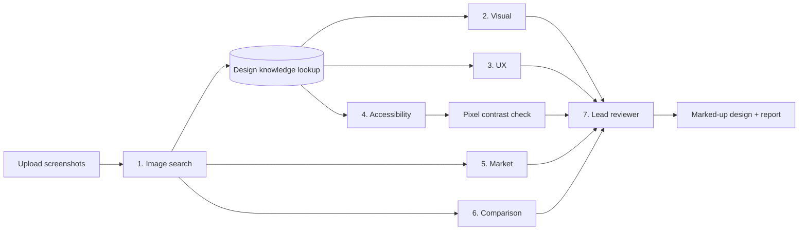

<p align="center"></p>

# DesignMind AI

Upload up to 3 screenshots of your product and get a design review in a few minutes. Six AI reviewers check the visuals, usability, accessibility and market, then pin the most important fixes onto your screenshots.

Built with Next.js, the Vercel AI SDK and OpenRouter. Runs on Vercel.

**Live demo:** [designmind-ai-azure.vercel.app](https://designmind-ai-azure.vercel.app/)

## How it works



After step 1, the app picks the most relevant notes from a built-in library (Nielsen's heuristics, WCAG 2.2 and design principles) and gives them to steps 2–4. Step 4 then measures contrast from the screenshot pixels in your browser.

| Step | What it does |
| --- | --- |
| 1. Image search | Describes each screen and finds similar, well-rated apps on the web |
| 2. Visual analysis | Layout, spacing, colour, type and hierarchy |
| 3. UX critique | Scores Nielsen's 10 usability heuristics |
| 4. Accessibility | Measures colour contrast from the pixels (WCAG 2.2) and estimates target sizes |
| 5. Market research | Searches the web for the top competitors and trends, with sources |
| 6. Design comparison | Picks the stronger screen in each area |
| 7. Lead reviewer | Removes repeats, ranks the fixes and scores each screen |

Steps 2–6 run at the same time. Results show as numbered pins on your screenshots plus 7 tabs, and you can export a PDF or JSON. The **Quick Walk-through** page has a finished example review and a short product tour video.

## Run it locally

You need Node.js 22 or newer.

```bash
npm install
cp .env.example .env.local   # add your OpenRouter key after OUTSKILL_OPENROUTER_API_KEY=
npm run dev                  # open http://localhost:3000
```

## API keys

The app uses one OpenRouter key, in one of two ways:

- **Default key:** the server reads `OUTSKILL_OPENROUTER_API_KEY`. Visitors don't need to set anything up.
- **Bring your own key:** a visitor pastes their own OpenRouter key on the home page. It's kept only in that browser tab and is never stored or logged.

A bring-your-own-key request never falls back to the default key. Set a credit limit on the default key in OpenRouter, because anyone with the site URL can use it.

## Deploy to Vercel

1. Import this repo at [vercel.com/new](https://vercel.com/new).
2. Add the environment variable `OUTSKILL_OPENROUTER_API_KEY`.
3. Click **Deploy**. Each push to `main` redeploys automatically.

## Tests

```bash
npx playwright install chromium   # first time only
npm run test:responsive           # checks mobile, laptop and desktop layouts
```

To see a finished review without a key, open **Quick Walk-through** in the app.

## Limitations

- Reviews are saved only in the browser that created them.
- Target sizes are estimates. Small, thin text can measure slightly low, so near-misses are marked "Borderline".
- A full review takes about 2–3 minutes. Check the OpenRouter Activity page for what it costs.

## Scope (v0.1.0)

Below is a summary of what v0.1.0 includes (in scope) and what it leaves out (out of scope).

### In scope

1. Three pages: Home (`/`), Review (`/review/<id>`) and an example review (`/examples/example-compare`) that works with no key and no API calls.
2. Two key options, the Outskill key or bring your own key (BYOK), with **Test key** and **Clear key** buttons, a "Key in use" label and no silent switch to the Outskill key if a BYOK key fails.
3. A model dropdown with 4 options (Gemini 3.8 Flash by default) and a custom model field, under an Advanced section.
4. Upload of up to 3 screenshots (PNG, JPEG or WebP), resized in the browser, with optional product name, website and target audience.
5. A seven-step review, described in [How it works](#how-it-works).
6. Similar apps and market findings linked to their web sources.
7. A live "N of 7 steps finished" counter, a status for each step and a retry if one fails.
8. Reviews saved in the browser, so reloading mid-review continues where it left off.
9. Results as numbered pins on the screenshots plus seven tabs, with an optional **Export PDF**, **Download JSON** and **Start a new review**. Nothing downloads automatically.
10. A responsive, light-only layout for mobile, laptop and desktop, checked by automated screenshot tests.

### Out of scope

- Figma links, .fig files and PDF uploads.
- More than 3 screenshots.
- Any model or search provider other than OpenRouter.
- User accounts, a database, or saving reviews on a server.
- Per-visitor rate limits or an access code on the Outskill key.

## Acknowledgements

**Design guidance the reviewers use:**

- [10 Usability Heuristics for User Interface Design](https://www.nngroup.com/articles/ten-usability-heuristics/), Jakob Nielsen, Nielsen Norman Group
- [Web Content Accessibility Guidelines (WCAG) 2.2](https://www.w3.org/TR/WCAG22/), W3C, including the contrast ratio formula and target sizes
- Gestalt principles of visual perception (proximity, similarity, common region)

**Services and libraries:**

- [OpenRouter](https://openrouter.ai) for the AI models, and its web search powered by [Exa](https://exa.ai)
- [Next.js](https://nextjs.org), [React](https://react.dev) and the [Vercel AI SDK](https://ai-sdk.dev)
- [Zod](https://zod.dev), [jsPDF](https://github.com/parallax/jsPDF), [jsPDF-AutoTable](https://github.com/simonbengtsson/jsPDF-AutoTable) and [idb-keyval](https://github.com/jakearchibald/idb-keyval)
- [Tailwind CSS](https://tailwindcss.com) and [Playwright](https://playwright.dev)
- Fonts: [Atkinson Hyperlegible](https://fonts.google.com/specimen/Atkinson+Hyperlegible) by the Braille Institute and [Manrope](https://fonts.google.com/specimen/Manrope) by Mikhail Sharanda, both under the SIL Open Font License
- Hosted on [Vercel](https://vercel.com)

**Tools:** vibe coded with the help of [Claude Code](https://claude.com/claude-code).

## License

[MIT](LICENSE). v0.1.0 © 2026 the DesignMind AI hackathon team: RaeesBasheer, lourien, Savvy-Workspace, AidenKitayimbwa and investwelltech.
